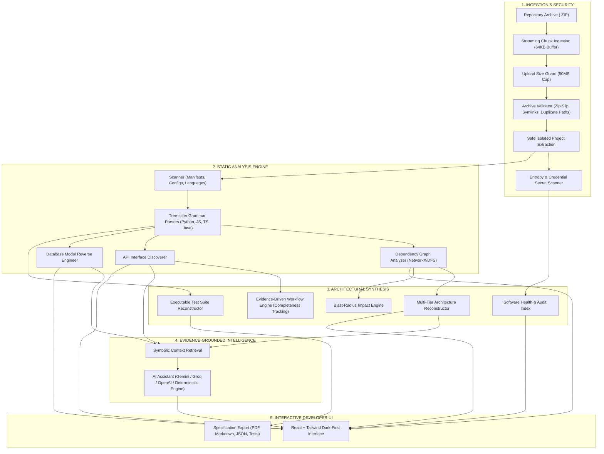

# CODEX (PS06) — Autonomous Software Reverse Engineering & Code Intelligence

> **Aarambh Hackathon — Orion, School of Computer Science & Engineering**  
> **Domain:** Software Engineering | Generative AI | Code Intelligence  
> **Core Principle:** `CODE → UNDERSTANDING → INTELLIGENCE`

[](backend/tests/)
[](backend/app/engine/parser.py)
[](https://fastapi.tiangolo.com)
[](https://react.dev)
[](#architecture)
[](LICENSE)

---

## 1. Executive Product Vision

Organizations regularly acquire legacy applications, inherit undocumented codebases, or undertake high-risk migrations without access to original developers or architecture specs.

**CODEX** is an autonomous software reverse engineering and code intelligence platform. It ingests software repositories, performs native Abstract Syntax Tree (AST) parsing via Tree-sitter grammars, constructs dependency graphs, discovers REST API interfaces, reverse-engineers database models, and generates evidence-grounded technical specifications and reconstructed test suites.

> [!IMPORTANT]
> **Zero-Hallucination Guarantee:** CODEX does **not** invent code structures or hallucinate endpoints. AI reasoning is strictly anchored in verified static technical evidence extracted from ASTs and configuration manifests. If no AI API key is configured, CODEX executes a 100% deterministic factual engine.

---

## 2. Hardened Architecture & Independent Audit Remediations

Following an independent code-level audit, CODEX was comprehensively hardened:

1. **Native Tree-sitter Grammar Parsing (P0):** Replaced heuristic regex parsers with formal Tree-sitter AST parsers for JavaScript, TypeScript, TSX, Java, and Python. Extracts accurate node ranges (`start_line`, `end_line`), parameters, signatures, interfaces, classes, and call hierarchies without artificial line offsets.
2. **Evidence-Driven Workflow Reconstruction (P0):** Reconstructed execution workflows follow strict verification chains: `Frontend Client Event → Route Controller → Domain Service → Data Access → Database`. Every step records exact line citations and confidence (`confirmed` vs `inferred`). Workflows track `completeness` and explicit `missing_evidence` without hallucinating database persistence.
3. **Executable Test Case Reconstruction (P0):** Eliminated `pass` placeholder bodies. Test suites synthesize realistic arguments, import actual target modules, and assert positive, negative, and boundary conditions. Authentication checks are generated **strictly** when authentication middleware is discovered.
4. **Streaming Upload & Size Enforcement (P0):** Implemented streaming 64KB chunk writes to disk. Archives exceeding `MAX_UPLOAD_SIZE_MB` (default 50MB) are immediately rejected with HTTP 413 and partial uploads are safely cleaned up. Enforced archive entry validation against symlinks, special devices, and duplicate-path collisions.
5. **Functional Settings & Key Security (P1):** Real settings persistence via `/api/settings` and `/api/settings/test`. Supports Gemini, Groq, OpenAI, Local models, and Deterministic fallback. Sensitive API keys are never exposed in API responses or browser storage.
6. **Localhost Single-User Security (P1):** Restricted default host binding to `127.0.0.1`, strict CORS origins, path traversal guards on file exploration and project deletion, and enhanced secret detection (AWS, GitHub PATs, Slack tokens, Google keys, JWTs).



---

## 3. Core Functional Modules

| Module | Implementation | Evidence & Verification |
|---|---|---|
| **Module A: Repository Scanner** | Traverses directory tree, ignores build artifacts, detects 20+ file types, detects frameworks via `package.json`, `requirements.txt`, `pom.xml`, etc. | Language percentages, LOC count, and manifest citations. |
| **Module B: Application Intelligence** | Tree-sitter grammar parsing for Python, TypeScript, JavaScript, and Java. Extracts classes, methods, functions, calls, and signatures. | File path, exact AST start/end lines, docstrings, call hierarchies. |
| **Module C: AST Analysis** | Extracts hierarchical AST structure for visual exploration with syntax-level statement classification. | Interactive node tree linked to verified source line numbers. |
| **Module D: Dependency Graph** | Builds directed graph of file and module imports. Detects circular dependency cycles and high-degree hub hotspots. | Interactive graph, cycle detection, and **Blast-Radius Impact Analysis**. |
| **Module E: Architecture Reconstruction** | Classifies application into Presentation, API, Business Logic, Data Access, and Database tiers. | Component responsibilities, incoming/outgoing requests, verified links. |
| **Module F: Database Reverse Engineering** | Extracts models, tables, columns, primary/foreign keys from SQLAlchemy, Prisma, Django, and SQL schemas. | Relational ER diagram nodes & edges, verified vs. inferred constraints. |
| **Module G: API Discovery** | Discovers endpoints from FastAPI, Flask, Express, Django REST, and Spring Boot. Extracts verbs, parameters, and auth requirements. | Complete OpenAPI 3.0 specification export. |
| **Module H: AI Assistant & Settings** | Grounded question-answering with citation links. Fully configurable via Settings page. | Multi-provider (Gemini, Groq, OpenAI, Local) + **Deterministic Fact Fallback**. |
| **Module I: Health & Migration** | Evidence-based health score (0-100), detects circular dependencies, hardcoded secrets, complexity, and legacy tech debt. | Weighted arithmetic formula with clear deduction justifications. |
| **Module J: Documentation Engine** | Autonomous 14-section architectural report. | One-click export to Markdown (`.md`), JSON (`.json`), and PDF (`.pdf`). |
| **Module K: Test Reconstruction** | Reconstructs positive, negative, and boundary suites with synthesized parameters. | Ready-to-review test suites for `pytest` and `vitest`. |

---

## 4. Quick Start & Local Execution

### Prerequisites
- Python 3.10+ (Tested on Python 3.14)
- Node.js 18+ (Tested on Node.js v26)
- Git

### 1. Set Up Backend & Virtual Environment
```bash
# Navigate to project directory
cd CODEX_Hackathon

# Create and activate virtual environment
python3 -m venv .venv
source .venv/bin/activate  # On Windows: .venv\Scripts\activate

# Install backend dependencies
pip install -r requirements.txt

# Verify all 21 automated integration tests pass
pytest -v
```

### 2. Set Up Frontend & Build Production Bundle
```bash
# Install frontend dependencies
npm install --prefix frontend

# Build optimized production bundle
npm run build --prefix frontend
```

### 3. Launch CODEX
```bash
# Start backend (serves API + compiled frontend simultaneously on port 8000)
source .venv/bin/activate
uvicorn backend.app.main:app --host 127.0.0.1 --port 8000
```
Open **[http://127.0.0.1:8000](http://127.0.0.1:8000)** in your browser!

*(Optional: For frontend development mode with hot-reloading, run `npm run dev --prefix frontend` on port 5173).*

---

## 5. Docker Deployment

```bash
# Build and run unified container with Docker Compose
docker-compose up --build
```
Access the application at `http://localhost:8000`.

---

## 6. Hackathon Live Demonstration Script (5-Minute Tour)

Follow these steps for a live presentation to hackathon judges:

1. **Landing Page (`/`):**
   - Showcase CODEX branding and the core principle: `CODE → UNDERSTANDING → INTELLIGENCE`.
2. **Instant Demo Repo Ingestion (`/upload`):**
   - Click **"Load Demo Repo"** to ingest the bundled `sample_project.zip` (NovaCommerce E-Commerce Store).
   - Observe live scanning of 18 files, detecting Python, TypeScript, FastAPI, SQLAlchemy, and React.
3. **Project Overview (`/projects/:id`):**
   - View repository metrics: 18 files, 383 lines of code, 7 discovered REST endpoints, 4 database models, Health Score 83/100.
4. **Architecture Explorer (`/projects/:id/architecture`):**
   - Inspect reconstructed application tiers (Presentation → API Gateway → Domain Services → Database Layer).
5. **Dependency Graph & Blast-Radius (`/projects/:id/dependencies`):**
   - Inspect import relationships and run the **Impact Analysis Engine** on `models/user.py` to see affected direct and transitive dependents.
6. **Database Reverse Engineering (`/projects/:id/database`):**
   - View discovered relational schemas (`User`, `Product`, `Order`, `OrderItem`), field constraints, and primary/foreign key connections.
7. **API Explorer (`/projects/:id/apis`):**
   - Browse cataloged endpoints (`/auth/register`, `/auth/login`, `/orders`, `/products`), parameters, and download the auto-generated **OpenAPI 3.0 specification**.
8. **AI Assistant (`/projects/:id/assistant`):**
   - Ask: *"Explain how user registration works in this application"*
   - Show how CODEX provides a cited, verifiable explanation backed by the deterministic fact index.
9. **Settings & Provider Configuration (`/settings`):**
   - Demonstrate the functional Settings page: test connection to Deterministic Fact Engine or Gemini, and show safe key masking.
10. **Documentation Report (`/projects/:id/docs`):**
    - Review the complete 14-section architectural report and download **PDF**, **Markdown**, or **JSON**.
11. **Test Reconstruction (`/projects/:id/tests`):**
    - Inspect positive, negative, and boundary test suites generated with synthesized arguments.

---

## 7. Security & Safety Controls

1. **Zip Slip Prevention:** Rejects any archive member with `..` path traversal or absolute destinations.
2. **Zip Bomb Mitigation:** Strict limits on decompressed file size (250MB cap) and file count (10,000 files).
3. **Streaming Upload Guard:** Capped at 50MB during stream, rejects oversized payloads with HTTP 413 and deletes partial files.
4. **Symlink & Special File Rejection:** Archive entries containing symlinks or FIFO devices are strictly blocked.
5. **Execution Boundary:** Uploaded untrusted code and generated tests are **never** executed directly on the host server.
6. **Secret Scanner:** Flags hardcoded AWS keys, GitHub PATs, Slack tokens, Google API keys, JWTs, and database URIs.

---

## 8. Automated Test Coverage (21/21 Passing)

```bash
source .venv/bin/activate
pytest -v
```

| Test Case | Module | Description | Result |
|---|---|---|---|
| `test_javascript_treesitter_parsing` | AST Parser | Tree-sitter JS functions, exports, calls | PASSED |
| `test_typescript_treesitter_parsing` | AST Parser | Tree-sitter TS interfaces, classes, methods | PASSED |
| `test_tsx_component_treesitter_parsing` | AST Parser | Tree-sitter React TSX component parsing | PASSED |
| `test_java_treesitter_parsing` | AST Parser | Tree-sitter Java classes & method ranges | PASSED |
| `test_circular_dependency_detection` | Graph | DFS circular dependency detection | PASSED |
| `test_zip_duplicate_entries_rejected` | Security | Rejection of duplicate archive entries | PASSED |
| `test_zip_symlink_disallowed` | Security | Rejection of symlinks in archives | PASSED |
| `test_enhanced_secret_detection` | Security | Detection of GitHub PAT, Google key, JWT | PASSED |
| `test_workflow_reconstruction_evidence_driven` | Workflows | Evidence-driven execution & missing citations | PASSED |
| `test_test_reconstructor_zero_pass_placeholders` | Test Gen | Parameter synthesis & zero placeholder code | PASSED |
| `test_documentation_markdown_generation` | Docs | 14-section markdown generation | PASSED |
| `test_settings_api_masked_and_update` | API & Settings | Credentials masking & provider test endpoints | PASSED |
| `test_upload_streaming_rejects_oversized` | Streaming Upload | HTTP 413 on upload > MAX_UPLOAD_SIZE_MB | PASSED |
| `test_zip_security_path_traversal` | Security | Zip slip path traversal guard | PASSED |
| `test_secret_scanner` | Security | AWS & credential detection | PASSED |
| `test_repository_scanner_on_sample_project` | Scanner | Language & framework identification | PASSED |
| `test_python_ast_parser` | AST Parser | Python classes, routines, calls | PASSED |
| `test_api_discoverer_on_sample_project` | API Discovery | FastAPI decorators & OpenAPI schema | PASSED |
| `test_database_analyzer_on_sample_project` | DB Analyzer | SQLAlchemy models & foreign keys | PASSED |
| `test_dependency_graph_and_impact` | Graph | Dependency topology & blast radius | PASSED |
| `test_health_report` | Health Index | Arithmetic health scoring formula | PASSED |

---

## 9. Limitations & Future Scope

- **Static vs. Dynamic Analysis:** CODEX currently prioritizes static AST analysis. Runtime profiling requires containerized execution sandboxes.
- **Language Grammars:** Full native AST parsing is implemented for Python, JavaScript, TypeScript, and Java via Tree-sitter. Languages like C# and Go currently have lexical extraction with full AST grammar parsing planned for v2.0.
- **Microservices Boundary:** Works best on monorepos and standalone repositories; distributed tracing across multiple distinct git repositories is planned.

---

**Developed for Aarambh Hackathon — Orion, School of Computer Science & Engineering**
