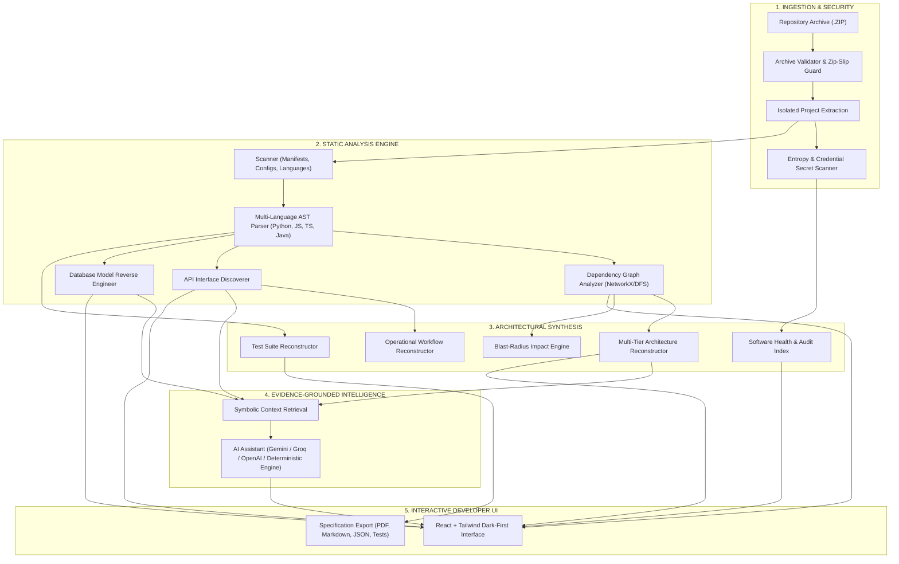

# CODEX (PS06) — Autonomous Software Reverse Engineering & Code Intelligence

> **Aarambh Hackathon — Orion, School of Computer Science & Engineering**  
> **Domain:** Software Engineering | Generative AI | Code Intelligence  
> **Core Principle:** `CODE → UNDERSTANDING → INTELLIGENCE`

[](backend/tests/test_codex_engine.py)
[](https://fastapi.tiangolo.com)
[](https://react.dev)
[](#architecture)
[](LICENSE)

---

## 1. Executive Product Vision

Organizations regularly acquire legacy applications, inherit undocumented codebases, or undertake high-risk migrations without access to original developers or architecture specs.

**CODEX** is an autonomous software reverse engineering and code intelligence platform. It ingests software repositories, performs native Abstract Syntax Tree (AST) parsing, constructs dependency graphs, discovers REST API interfaces, reverse-engineers database models, and generates evidence-grounded technical specifications and reconstructed test suites.

> [!IMPORTANT]
> **Zero-Hallucination Guarantee:** CODEX does **not** invent code structures or hallucinate endpoints. AI reasoning is strictly anchored in verified static technical evidence extracted from ASTs and configuration manifests. If no AI API key is configured, CODEX executes a 100% deterministic factual engine.

---

## 2. Reconstructed System Architecture



---

## 3. Core Functional Modules

| Module | Implementation | Evidence & Verification |
|---|---|---|
| **Module A: Repository Scanner** | Traverses directory tree, ignores build artifacts, detects 20+ file types, detects frameworks via `package.json`, `requirements.txt`, `pom.xml`, etc. | Language percentages, LOC count, and manifest citations. |
| **Module B: Application Intelligence** | AST parsing for Python, TypeScript, JavaScript, and Java. Extracts classes, methods, functions, calls, and signatures. | File path, start/end line numbers, docstrings, call hierarchies. |
| **Module C: AST Analysis** | Extracts hierarchical AST structure for visual exploration with syntax-level statement classification. | Interactive node tree linked to source line numbers. |
| **Module D: Dependency Graph** | Builds directed graph of file and module imports. Detects circular dependency cycles and high-degree hub hotspots. | Interactive graph, cycle detection, and **Blast-Radius Impact Analysis**. |
| **Module E: Architecture Reconstruction** | Classifies application into Presentation, API, Business Logic, Data Access, and Database tiers. | Component responsibilities, incoming/outgoing requests, verified links. |
| **Module F: Database Reverse Engineering** | Extracts models, tables, columns, primary/foreign keys from SQLAlchemy, Prisma, Django, and SQL schemas. | Relational ER diagram nodes & edges, verified vs. inferred constraints. |
| **Module G: API Discovery** | Discovers endpoints from FastAPI, Flask, Express, Django REST, and Spring Boot. Extracts verbs, parameters, and auth requirements. | Complete OpenAPI 3.0 specification export. |
| **Module H: AI Assistant** | Grounded question-answering with citation links. | Multi-provider (Gemini, Groq, OpenAI, Local) + **Deterministic Fact Fallback**. |
| **Module I: Health & Migration** | Evidence-based health score (0-100), detects circular dependencies, hardcoded secrets, complexity, and legacy tech debt. | Weighted arithmetic formula with clear deduction justifications. |
| **Module J: Documentation Engine** | Autonomous 14-section architectural report. | One-click export to Markdown (`.md`), JSON (`.json`), and PDF (`.pdf`). |
| **Module K: Test Reconstruction** | Reconstructs positive, boundary, and auth verification suites. | Ready-to-review test suites for `pytest` and `vitest`. |

---

## 4. Quick Start & Local Execution

### Prerequisites
- Python 3.10+ (Tested on Python 3.14)
- Node.js 18+ (Tested on Node.js v26)
- Git

### 1. Clone & Set Up Backend
```bash
# Navigate to project directory
cd CODEX_Hackathon

# Create and activate virtual environment
python3 -m venv .venv
source .venv/bin/activate  # On Windows: .venv\Scripts\activate

# Install backend dependencies
pip install -r requirements.txt greenlet

# Verify automated tests pass
pytest
```

### 2. Set Up Frontend & Build
```bash
# Install frontend dependencies
npm install --prefix frontend

# Build optimized production bundle
npm run build --prefix frontend
```

### 3. Launch CODEX
```bash
# Start backend (which serves API + compiled frontend simultaneously on port 8000)
source .venv/bin/activate
uvicorn backend.app.main:app --host 127.0.0.1 --port 8000
```
Open **[http://127.0.0.1:8000](http://127.0.0.1:8000)** in your browser!

*(Optional: For frontend hot-reloading development mode, run `npm run dev --prefix frontend` on port 5173).*

---

## 5. Docker Deployment

```bash
# Build and run unified container with Docker Compose
docker-compose up --build
```
Access the application at `http://localhost:8000`.

---

## 6. Hackathon Live Demonstration Script (5-Minute Tour)

Follow these steps for a live presentation to hackathon judges:

1. **Landing Page (`/`):**
   - Showcase CODEX branding and the core principle: `CODE → UNDERSTANDING → INTELLIGENCE`.
2. **Instant Demo Repo Ingestion (`/upload`):**
   - Click **"Load Demo Repo"** to ingest the bundled `sample_project.zip` (NovaCommerce E-Commerce Store).
   - Observe live scanning of 18 files, detecting Python, TypeScript, FastAPI, SQLAlchemy, and React.
3. **Project Overview (`/projects/:id`):**
   - View repository metrics: 18 files, 383 lines of code, 7 discovered REST endpoints, 4 database models, Health Score 83/100.
4. **Architecture Explorer (`/projects/:id/architecture`):**
   - Inspect reconstructed application tiers (Presentation → API Gateway → Domain Services → Database Layer).
5. **Dependency Graph & Blast-Radius (`/projects/:id/dependencies`):**
   - Inspect import relationships and run the **Impact Analysis Engine** on `models/user.py` to see affected direct and transitive dependents.
6. **Database Reverse Engineering (`/projects/:id/database`):**
   - View discovered relational schemas (`User`, `Product`, `Order`, `OrderItem`), field constraints, and primary/foreign key connections.
7. **API Explorer (`/projects/:id/apis`):**
   - Browse cataloged endpoints (`/auth/register`, `/auth/login`, `/orders`, `/products`), parameters, and download the auto-generated **OpenAPI 3.0 specification**.
8. **AI Assistant (`/projects/:id/assistant`):**
   - Ask: *"Explain how user registration works in this application"*
   - Show how CODEX provides a cited, verifiable explanation backed by the deterministic fact index.
9. **Documentation Report (`/projects/:id/docs`):**
   - Review the complete 14-section architectural report and download **PDF**, **Markdown**, or **JSON**.
10. **Test Reconstruction (`/projects/:id/tests`):**
    - Inspect positive, negative, and authentication verification suites generated for `pytest` and `vitest`.

---

## 7. Security & Safety Controls

1. **Zip Slip Prevention:** Rejects any archive member with `..` path traversal or absolute destinations.
2. **Zip Bomb Mitigation:** Strict limits on decompressed file size (250MB cap) and file count (10,000 files).
3. **Execution Boundary:** Uploaded untrusted code and generated tests are **never** executed directly on the host server.
4. **Secret Scanner:** Flags hardcoded AWS keys, database URIs, and generic tokens.

---

## 8. Automated Test Coverage

Run the backend test suite:
```bash
source .venv/bin/activate
pytest -v
```
**Test Results:**
- `test_zip_security_path_traversal` — PASSED (guards against malicious zip slip)
- `test_secret_scanner` — PASSED (verifies credential discovery)
- `test_repository_scanner_on_sample_project` — PASSED (verifies language & framework detection)
- `test_python_ast_parser` — PASSED (verifies AST routine extraction)
- `test_api_discoverer_on_sample_project` — PASSED (verifies FastAPI route discovery)
- `test_database_analyzer_on_sample_project` — PASSED (verifies SQLAlchemy schema extraction)
- `test_dependency_graph_and_impact` — PASSED (verifies dependency graph & blast radius)
- `test_health_report` — PASSED (verifies evidence-backed health calculation)

---

## 9. Limitations & Future Scope

- **Static vs. Dynamic Analysis:** CODEX currently prioritizes static AST analysis. Runtime profiling requires containerized execution sandboxes.
- **Language Grammars:** Full native AST parsing is implemented for Python, JavaScript, TypeScript, and Java. Languages like C# and Go currently have lexical extraction with full AST grammar parsing planned for v2.0.
- **Microservices Boundary:** Works best on monorepos and standalone repositories; distributed tracing across multiple distinct git repositories is planned.

---

**Developed for Aarambh Hackathon — Orion, School of Computer Science & Engineering**
